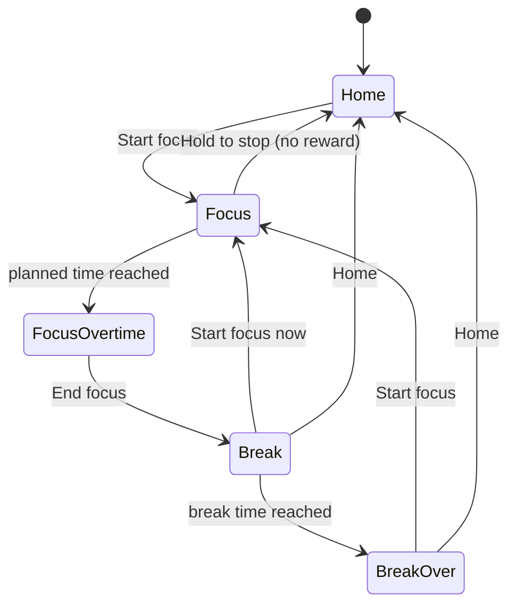

# ARCHITECTURE.md

> The coding agent's reference for structure, rules and settled decisions. `docs/reference/DESIGN.md` covers look and feel.
> `(ADR-0xx)` tags point to the human-facing log `docs/logs/DECISIONS.md`; the rule stated here is what counts. Bare doc names in code comments (`DESIGN.md 7.5`) mean the file in its `docs/` folder (map: `docs/README.md`).
> `[ASSUMPTION]` = default applied, not yet confirmed by the owner (see §12).

## 1. Product

- **Sift**: Pomodoro-style focus timer with collectible rewards (inspiration: Focus Pomo).
- **Loop**: focus → earn a random animal → it is placed on a floating voxel island → the island grows → focus again.
- **Platforms**: Phase 1 local desktop web app (done). Phase 2 iOS/Android by wrapping the same code with Capacitor (deferred, ADR-002).
- **Work model**: features come from `docs/plans/guidance_vN.md`, implemented step by step (guidance_v2 is the current one).

**Philosophy**: focus is the product, rewards are the garnish. Honest time: rewards only for real, completed focus. Gentle motivation: longer focus helps only slightly, and nothing worse than "no reward" ever happens. The island records accumulated effort.

**Immersion principles** (win every conflict):
1. Nothing interrupts focus: no popups, toasts, badges, or reward animations.
2. Focus shows only the timer over a dimmed island; controls stay hidden until needed.
3. Each cycle transition is one tap.
4. Rewards are revealed only on Break.
5. The timer is never wrong (tab switches, backgrounding, reloads).

## 2. Stack and conventions

| Area | Choice |
|---|---|
| Language / build | TypeScript (strict), Vite |
| UI | React 18, CSS Modules + CSS custom properties from `tokens.css` (ADR-001) |
| 3D | three.js + @react-three/fiber. No drei: custom `CameraRig` (ADR-009) |
| State | Zustand (store with injectable deps) |
| Storage | IndexedDB via Dexie, behind `StorageAdapter` |
| Sound | Synthesized with Web Audio, no audio files (ADR-006) |
| Tests | Vitest (logic), Playwright smoke test `npm run e2e` |
| Mobile (later) | Capacitor |

- All code, comments, docs, commits and UI text in English. UI strings only in `src/ui/strings.ts`.
- **Gameplay** tunables (reward odds, timer limits, placement, and later gold, scoring, war) live in `shared/balance/balance.ts` (frozen, with `BALANCE_VERSION`; bump it on every value change). Client-only tunables (render, UI, island shape) live in `src/domain/config.ts`. Visual values come from `DESIGN.md`; never inline new ones (ADR-030).

## 3. Screens and flow



| Screen | Rules |
|---|---|
| Home | Island with idle animals; limited rotate/zoom; current cycle + Start focus; top bar (theme, collection, settings) |
| Focus | Fullscreen + wake lock. Near-black overlay over the island as it was at focus start. Large timer only. Hidden "Hold to stop" (1.5 s long press) shows for 3 s on pointer move. At planned time: count-up `+05:23`, one chime, permanent End focus button |
| Break | Reward reveal (card fades in, model spins, tier chime; after 3.5 s or tap the animal joins the island; buttons usable throughout, ADR-011) or a neutral no-reward message. Break countdown, then "Ready for the next one?" with chime. Never auto-starts focus |
| Settings | Focus 5–60 min (step 5), break 1–30 min, chimes toggle, week starts on Monday/Sunday (only with `features.stats`); saves instantly |
| Inbox | Deferred notices (`domain/inbox`, store `inbox`, Dexie `inbox`): queued at any time, shown one at a time (oldest first) as a `NoticeCard` on Home and Break only; `dismissNotice` is a no-op while focusing, `selectCurrentNotice` returns nothing during Focus. Visual events tied to a notice play when it is shown, not when the data changed (ADR-035) |
| Tabs | Island (Home/Focus/Break + Settings/Collection pages), Stats, Friends, Group; non-Island tabs appear only with their feature flag, and with one tab there is no tab bar. `activeTab` lives in the store, in memory only (every launch opens on Island). Focus always runs on Island and hides the tab bar; `setTab` is ignored while focusing, and leaving Island ends a running reveal. Space and hold-Esc exist only on Island screens. Other tabs cover the canvas, which stays mounted with `frameloop="never"`; during a break they show a pill with the break timer (ADR-036) |
| Stats | `domain/stats/days.ts`: `aggregateByDay(sessions, { timeZone, from, to })` → one `DayStat` per day (zeros included); `monthSummary(days, { today })`. Only `completed` sessions count (`balance.stats.includeAbandoned`); minutes = real `endedAt − startedAt` (not the reward cap); a session belongs to the local day it **started** in the user's current time zone. Daily average = month total ÷ days elapsed (through today in the current month, all days in past months). Epoch → local date via `Intl.DateTimeFormat`; calendar math on `YYYY-MM-DD` strings in UTC (ADR-037) |
| Economy | `features.economy`. Gold = sum of the append-only `ledger` store (`domain/economy/ledger.ts`), cached as store `gold`, recomputed on load. `spendGold(amount, reason, refId, grant)` writes debit + granted item in one transaction or fails (`InsufficientGoldError`, no memory fallback). 30 starter gold once per save (`starter` entry) (ADR-039). **Expiry** (`shared/rules/expiry.ts` `computeExpirations`): an active animal departs at exactly `acquiredAt + 7 days` (Unicorn exempt) and leaves gold by rank `[1, 3, 8, 25]`; `endedAt` = that moment. Store `applyExpirations` writes statuses, one credit per animal (`refId` = animal) and one `animals_departed` notice in one commit; it runs at start, after an import, on every transition to Home or Break and every 60 s while not focusing, never during Focus; one run at a time. Test-mode and dummy animals are memory-only: their departures never reach storage (ADR-040). **Departure presentation** (`pendingDepartures(inbox, phase)` in `domain/inbox`): departed animals named in a queued `animals_departed` notice stay drawn (`buildIslandModel` input `leaving`) until the notice is shown; the shown notice's animals get `IslandAnimal.departure` (order) and `world/animals/Departures.tsx` plays puffs and coin arcs (max `config.render.maxAnimatedDepartures` = 10, the rest vanish with one pile burst). `heldGold` = gold of unshown departure notices, which the HUD holds back. Their tiles are already free for new animals. **Coin pile**: `IslandModel.goldPileLevel` = `goldPileLevel(gold − heldGold, balance.economy.pileThresholds)` (0–6, 0 with the economy off), drawn by `world/props/CoinPile.tsx` (one instanced mesh, layout `pileVoxels`) on `COIN_PILE_TILE`. **HUD** (`screens/home/Hud.tsx`, Home's top bar only): `selectShownGold` (gold − held departure gold, counted up by `useCountUp`) and `selectActiveUnicorns`; gold opens an info bubble until the Shop exists. **Poke and Collection**: `buildIslandModel({ showExpiry })` adds `IslandAnimal.expiresAt` (not for exempt species) and the poke bubble shows `strings.poke.timeLeft`; Collection counts stay all-time plus `On island: n` |
| Collection | All 50 species (silhouettes if not owned, counts if duplicated) + stats: total focus time, completed sessions, species `n / 50` |
| Cosmetics | `features.cosmetics`. **Inventory** (`domain/cosmetics/inventory.ts`): `cosmetics` store, one row per owned instance (`{ id, kind, defId, acquiredAt, source }`); skins and themes are owned once, buildings any number of times; the default skin and theme are always owned; owned items stay usable after a newer pack drops them (the registry keeps retired items). `buyProblem` (unknown, not for sale: not purchasable / retired / outside its window / above `minClientVersion`, already owned, skin of a species never earned), `grantFor`; skins (ADR-043): `equipped.skinsBySpecies` = one or more chosen skins per species (`chosenSkins`, `chooseSkins`, `equipSkin` = only this one, `addSkin`, `toggleSkin`), a new animal gets `PlacedAnimal.skinId = pickSpawnSkin(...)` when several are chosen, and `skinForAnimal` draws its arrival skin while still chosen, else a fixed pick by id; `equipTheme`; `sanitizeEquipped` (lost or unknown items drop out; old `skinBySpecies` rows read as a choice of one), `unplacedBuildings` (owned − placed per definition). Store: `cosmetics`, `equipped` (kv `equipped`), `placedBuildings`; `buyItem(defId)` → `spendGold` (debit + item in one transaction, `BuyError` / `InsufficientGoldError`); `equipSkin`, `addSkin`, `toggleSkin`, `chooseSkins`, `equipTheme` (`EquipError`). `Commit` carries `equipped`, `buildingsPut`, `buildingsRemove`. App passes `equipped` and buildings to `buildIslandModel` only with the flag on. **Shop** (`screens/shop/ShopScreen.tsx`, view `shop`, opened from the HUD gold counter on Home): `domain/cosmetics/shop.ts` `shopView({ now, clientVersion, discovered })` → featured items of the newest started release (`newestRelease`), skins of earned species in catalog order, themes, buildings by category (`special` never sold); `itemBadges` (New for `balance.shop.newBadgeDays` = 14 after the release date, `leavesInMs` for limited items). Cards use atlas sprites; the confirm sheet shows a turning `ItemPreview` (skinned animal, building, or a small island in the theme) and offers Equip after buying a skin or theme |
| Build mode | `features.cosmetics`, view `build` (Home only, render mode `home` so the camera still turns). UI state in `screens/build/buildState.ts` (`buildUi`: `placing { defId, rotation, movingId? }`, ghost `tile`, `selected`), shared by the DOM panel (`BuildScreen`: tray of `unplacedBuildings`, Rotate/Cancel/Place, Move/Rotate/Store; keys R, arrows, Enter, Esc) and the in-canvas layer (`app/BuildIslandLayer` → `world/build/BuildLayer`: invisible instanced tile targets, ghost + footprint tint, selection outline; passed as `Scene` children). Hover moves the ghost with a mouse, a tap (≤ 6 px drag) moves it or selects a placed building. Store `placeBuilding({ defId, tile, rotation, movingId? })` → `PlaceProblem \| 'none_left' \| 'not_idle' \| null`: checks `placementProblem`, writes the building and the animals it displaces (`repairPlacements` with the new building) in one commit; `storeBuilding(id)`. `suggestTile` picks the first fitting tile from the center (empty tiles first). Animals whose home tile changes walk there |
| Island move | `features.islandMove` (ADR-046). `domain/island/move.ts` `moveIsland({ phase, world, animals, buildings, history, newSeed, now, rng, historyId })` → `MoveOutcome` or `'not_idle' \| 'no_unicorn'`: Home only; the oldest active Unicorn becomes `spent` (`endReason: island_move`); the world takes the new seed, island level unchanged (lifetime count); every other active animal gets a tile on the new terrain (`placeAnimals`, center-weighted, sharing when full), pins cleared, expiry clocks kept; every placed building returns to the inventory; an `islandHistory` row records the old seed (`from` = previous move or first animal). Store `rollIslandSeed()` (preview seeds, never the current one), `moveIsland(seed)` writes world, history, animals and building removals in one commit (`Commit.world`, `islandHistoryAdd`), then sets `islandMove` (memory only: old world, old animals, old buildings, spent id) for the sequence; `finishIslandMove()` ends it (Skip, end, reload). Entry: the HUD Unicorn counter opens `MoveIslandSheet` (preview via `SeedIslandPreview`, `balance.islandMove.freePreviews` = 3). Sequence: `world/sequences/moveTimeline.ts` (pure timeline: `planIslandMove`, `moverPose`, `stageAt`) + `IslandMove.tsx` (bridge, movers, burst), rendered as a `Scene` overlay with render mode `sequence`; reduced motion skips it with a crossfade |
| Content Studio | `/studio`, development builds only (`main.tsx` branch on `import.meta.env.DEV`, dropped from production). Lists every item and family with filters (kind, release, family, missing sprite, validation errors), previews it on a sample island through the normal `Scene` (3 terrains, day/night, any block theme, drag to rotate, presets running), edits names/prices/tags/availability, edits a skin family's transform with a live 50-species sprite grid and per-species overrides, and tests building placement (footprint tint, `placementProblem`, R rotates). Unsaved edits are a draft pack merged into the live registry. Save posts to the dev-server plugin `/__studio/save` (`vite.config.ts`, `apply: 'serve'`), which writes only item files under `content/` (`isWritableContentPath`, `formatContentJson`). In development an invalid file does not stop the app: `assemblePack` leaves the broken entries out and the Studio lists the problems (`baselineProblems`); production builds still fail on any problem |

## 4. Timer engine

```ts
type Phase =
  | { kind: 'idle' }
  | { kind: 'focus'; startedAt: number; plannedMs: number; sessionId: string }
  | { kind: 'focusOvertime'; startedAt: number; plannedMs: number; sessionId: string }
  | { kind: 'break'; startedAt: number; plannedMs: number; rewardId?: string }
  | { kind: 'breakOver'; rewardId?: string };
```

- Persist only `idle`, `focus`, `break`. `resolvePhase(phase, now)` derives `focusOvertime` / `breakOver`, so they cannot be missed (ADR-003).
- Elapsed = `now() - startedAt`, never accumulated ticks. Display ticks (250 ms) are not a source of truth. Recompute on `visibilitychange`. Phase is persisted on every change and restored on reload.
- **Focus end**, in one DB transaction (no double rewards): effective time `min(endedAt - startedAt, 60 min)` → if ≥ 25 min roll tier, species, tile → save session + animal + next `break` phase.
- Time-dependent logic takes an injected `now()`.

## 5. Rewards

- **Effective focus** = planned + overtime, capped at 60 min. **Minimum 25 min**. Abandon = no reward.
- Focus can be set below 25 min; such sessions earn only with overtime, and the no-reward message explains it (ADR-012) `[ASSUMPTION]`.
- **Tiers**, lowest to highest: Common < Mythic < Epic < Legendary (`TIERS` in `config.ts`; ADR-026/027).
- Tier is rolled; odds interpolate linearly from 25 to 60 min (`[ASSUMPTION]`); species is then uniform within the tier. Pure functions with an injectable RNG: `shared/rules/reward.ts` (generic over the catalog), bound to `CATALOG` in `domain/reward/reward.ts`.

| Tier | 25 min | 60 min | Species |
|---|---|---|---|
| Common | 60% | 50% | 25: Chick, Rabbit, Duck, Hamster, Squirrel, Hedgehog, Mouse, Frog, Fish, Snail, Ladybug, Bee, Butterfly, Beetle, Turtle, Crab, Starfish, Mole, Sparrow, Pigeon, Hen, Guinea Pig, Lizard, Bat, Ferret |
| Mythic | 28% | 32% | 14: Sheep, Pig, Cat, Dog, Goat, Raccoon, Penguin, Owl, Otter, Beaver, Capybara, Axolotl, Parrot, Koala |
| Epic | 10% | 14% | 9: Horse, Cow, Deer, Fox, Wolf, Bear, Panda, Red Panda, Peacock |
| Legendary | 2% | 4% | 2: Unicorn (rainbow mane, rainbow bursts), Tiger (forehead 王). Both sparkle |

- Catalog (`domain/animals/catalog.ts`) is read from the content registry: one `content/animals/<id>/animal.json` per animal, ordered by tier then id: `id`, `name`, `tierRank`, `tier` (label), `modelId` (the model ref `animals/<id>`), `idleAnimation`, `footprint`. Duplicates allowed; each is placed. A new animal is a new folder (ADR-045).
- **Tier rank, never names**: `TierRank` 0 Common … 3 Legendary. Odds (`config.reward.tierAt*` arrays), species pools, chimes (`reveal:<rank>`), styles (`data-tier="<rank>"`), and later gold, scoring and war all key off the rank. Names live only in `TIERS` (stored label) and `strings.tiers` (display); a rename touches those two lists. The only name comparisons left are the frozen Dexie v2/v3 upgrades.

## 6. 3D world

**Island model** (ADR-034)
- The world draws plain data, never the store: `domain/island/model.ts` `buildIslandModel(...)` → `IslandModel { ownerId, seed, islandLevel, blockThemeId, animals[{ id, speciesId, tierRank, tile, skinId }], buildings[], goldPileLevel, championWeek? }`; `IslandMode` = `own | visit | battle | move` (separate from the render mode).
- `world/Scene.tsx` owns the canvas, lights, camera, clouds and render driver and takes `islands: { model, mode }[]`; `world/IslandScene.tsx` draws one model (bob, terrain, stream, camp, animals) with no global state. Several islands sit side by side along the screen's horizontal axis and the camera fits them all; one island renders exactly as before.
- `Scene` islands are `{ model, mode, motion? }` keyed by owner + seed (an island keeps its scene node while others come and go). `motion` (`IslandMotion`): `lift` ref added to the height, `bobY` ref receives the bob, `calm` fades the bob out. `Scene.overlay(layout)` draws objects between islands in world space; `Scene.pan` (0..1) shifts the view until the last island is centered. Render mode `sequence` (`WorldMode`) = full rate, fixed camera, no panel insets, clouds on.
- Dev-only: `?twoIslands[=seed]` renders a second island (`app/devTwoIslands.ts`, stripped from production builds).

**Scene and camera**
- One persistent `<Canvas>` for Home, Focus and Break; never remounted. Break reward card uses its own small canvas only while visible; Collection, Day detail and Shop use generated pixel-art sprites from the content atlas (`ItemSprite`, `content.sprite(id)`; flat front-view `VoxelSprite` only as a fallback and for the Studio's live grid) (ADR-007, ADR-042).
- **Content pipeline checks** (ADR-042): `npm run content:validate` (`shared/content/validate.ts` after `assemblePack`) checks palette keys, budgets, footprint vs model bounds, `balance.prices`, availability dates and that every item has a fresh sprite (atlas stores an input hash per item). It runs in CI (`.github/workflows/ci.yml`) and inside `npm test`. `npm run content:sprites` (`tools/sprite-gen/main.mjs` → dev page `/studio/sprites` → `screens/studio/spriteRenderer.ts`) regenerates `content/sprites/atlas.{png,json}`.
- Orthographic isometric camera (azimuth 45°, elevation ≈ 35.26°). Fits the island top + 35% of the underside with a 5% margin, re-fits on growth, avoids the screen area under panels (ADR-014).
- Render modes: Home full (60 fps, interaction: drag turns the camera within `config.render.azimuthLimitDeg` = ±135°; the sun and clouds sit in a group that turns with the shown camera azimuth, `CameraControls.shown`). Focus dimmed: fixed camera, 24 fps cap, animals at 0.25 speed, no clouds, 1 s camera pull-back. Break full, fixed camera.

**Island**
- Deterministic: same seed + same **island level** = same island. `islandLevel` = lifetime earned animals on this save, whatever their status (`domain/island/level.ts`), so departures never shrink the island (ADR-032). Shapes are **monotone** (growth only adds tiles), so stored animal coordinates (relative to center) stay valid. An island move keeps the level and changes only the seed.
- Size: side = `max(7, ceil(sqrt(level × 3)))`, odd. Near-circular outline (Euclidean + seeded jitter) (ADR-017).
- Terrain levels 1–3, each 0.5 block. Domain-warped noise + weak back-high tilt, terraced (mostly plains, some hills/lowlands), flat around the camp (ADR-018).
- Underside: inverted pyramid with random gaps. Blocks are flat-colored cubes, one `InstancedMesh` per type, ±4% tint (ADR-008).
- During Break with a reward, the island is sized from `level - 1`; the growth (700 ms scale-in) shows when returning Home (ADR-013).

**Camp and night mode** (ADR-016, ADR-017)
- `Settings.theme` `light | dark`, toggled from the top bar, locked during Focus.
- Campfire on (0,0), log cabin on (-2,0) with its door facing the fire, coin pile tile (-2,1) beside the cabin (the pile prop, F3). All three are `CAMP_RESERVED` (never used by animals or buildings) and flat; the pile tile lies inside the stream's camp clearance, so it is always dry.

**Occupancy** (ADR-033)
- `domain/island/occupancy.ts` `getOccupancy({ seed, islandLevel, animals, buildings })` → `Map<"x,z", TileInfo>` with `height, water, campReserved, buildingId?, animalIds, walkable, buildable`. Animal placement and save repair use it; building placement, routines, war formation and island moves must too.
- Save repair runs on every load (`repairPlacements`): an active animal on water, camp, a building or off the island moves to the nearest free tile and is saved. Idempotent.
- Focus routines picked by theme at focus start: day = animals walk into the cabin; night = they sleep near it. They return on Break. Reload into Focus shows the end state; reduced motion snaps.
- **Walking** (Step 3.12): `domain/island/path.ts` `findPath(grid, from, to)`, grid A* with 4-neighbor steps over walkable tiles (no buildings, camp or water except footbridges), at most one terrain level per step; the start and goal may be blocked. `IslandScene` builds the walk grid from the model's buildings (animals do not block each other); `Animals` walks routine legs (to the cabin door's front tile, to sleep spots, back home, to a new home tile) along tile centers, ending exactly at the target, and straight when there is no route.

**Stream** (ADR-020, ADR-021)
- One winding stream per island, from the seed only: best-scoring wobbling chord, avoids the camp, starts at a spring, falls off the rim outward. Cached per seed (~500 path traces).
- Stream tiles keep their natural level with a 0.25 bed cut; water never flows uphill; only the first unbroken run is water. Water tiles are excluded from placement.
- Modules: `domain/island/stream.ts` (path), `world/stream/streamMesh.ts` (ribbon, falls, bank mesh), `world/stream/Stream.tsx` (render, flow, stateless splash particles).

**Animals**
- One 1×1 tile per animal; placed on a random free grass tile near the center; idle stays in the tile: turn, hop, shuffle (ADR-005). Placement and save repair count buildings; with no free tile left, an animal shares the least crowded tile, at most `balance.placement.maxPerTile` (4) per tile, and sharers stand in its corners (Step 3.13).
- Exception: the butterfly flaps (separate wing meshes) and flies up to 1.2 tiles from its tile (ADR-024).
- World scale 0.25× (animal voxel = 1/6 block in the model, 1/24 on the island) (ADR-014).
- Model limits: width ≤ 6 voxels; depth ≤ 6, or 8 for Epic and Legendary (ADR-025).
- Poke: clicking an animal (not on Focus) shows a `!` bubble (with the economy on: its time left, e.g. `3d left`; Unicorn keeps `!`) and forces one idle action. Render-only state (ADR-022).
- **Skins, themes and buildings** (renderer, Steps 3.4/3.8): `world/voxel/geometry.ts` builds animal geometry per `(species, skin)` (species palette ← skin palette, overlay voxels via `withOverlay`), block meshes per theme palette (the island's instanced meshes swap geometry, the layout is not rebuilt), and building meshes per definition (`BUILDING_VOXEL` = 1/8 block, so a footprint tile is 8 voxels; parts are separate meshes around their pivot, animated by part presets; `light` glows at the model's `flame`/`glass` voxels). `IslandScene` reads `model.blockThemeId` for terrain, stream, camp and cloud colors and the theme's `ambient` particles (Home and Break only). Unknown skin or theme ids fall back to the default look. `clearContentGeometry()` drops cached meshes after content changes.
- **Building placement** (`domain/build/placement.ts` `placementProblem`, on the occupancy grid): every footprint tile on the island and at one height, no camp tile, no other building (the one being moved excepted), no water unless `allowOnWater`, and at least `balance.build.minFreeTiles` (6) land tiles left for animals; tiles with animals are allowed. `footprintTiles(tile, footprint, rotation)`: `tile` is the low-x/low-z corner, 90°/270° swap width and depth. Occupancy marks every footprint tile; a footbridge (`allowOnWater`) stays walkable (`bridge`) but animals never live on water (`isStandable`).
- **Behavior presets** (Step 3.2): reusable code in `world/presets/` (idle sets, part animations `spin/sway/bob/flap`, particle fields, light glows) referenced by id from content. `content/presets.json` lists the ids per kind; `buildPack` rejects unknown ids and a test keeps the list equal to the code (`PRESET_IDS`). A new preset is an app release; items using it set `minClientVersion`.
- Voxel models are content: `content/animals/<id>/model.ts` (builder `tools/content-build/animal.ts`), read through `content.model(ref)` (`world/voxel/geometry.ts` `modelById`), merged into one cached `BufferGeometry` per species (hidden faces culled). Voxels reference **named palette keys** (`shared/content/palette.ts`) with a default palette per model; terrain and camp colors are the keyed `defaultBlocks` record (`world/palette.ts`). Raw colors never appear in model shapes.

## 7. Platform layer

Capability APIs only through `src/platform/<name>/` (interface `index.ts`, web `web.ts`); native versions live together in `platform/native/index.ts` (ADR-050). `platform/index.ts` exports one `Platform` (`platform/types.ts`): `nativePlatform()` (`native/detect.ts`, reads `window.Capacitor`) picks the native set inside the iOS/Android apps, the web set otherwise. Capacitor plugins are imported only by `native/plugins.ts`, a lazily loaded chunk, so the web bundle carries none.

| Adapter | Web | iOS / Android (Capacitor 8) |
|---|---|---|
| `StorageAdapter` | IndexedDB (Dexie) | SQLite file (`storage/sqlite.ts` over `SqlDriver`; driver `native/sqliteDriver.ts`, `@capacitor-community/sqlite`) |
| `WakeLockAdapter` | Screen Wake Lock API | `@capacitor-community/keep-awake` |
| `FullscreenAdapter` | Fullscreen API | status bar hidden (`@capacitor/status-bar`) |
| `NotifyAdapter` | Web Audio chimes; `schedule` no-op | chimes in the foreground; `schedule` = local notifications (`@capacitor/local-notifications`, ids 1 focusEnd / 2 breakEnd, Android channels `timer` / `timer_silent`) |
| `HapticsAdapter` | no-op | `@capacitor/haptics` (light on reveal, medium on war result) |
| `FilesAdapter` | download link / file picker | file in Cache + share sheet; the WebView file input for open |
| `SecureStorageAdapter` | `localStorage` | Keychain / Keystore (`@aparajita/capacitor-secure-storage`) |
| `LifecycleAdapter` | `visibilitychange`, `online` | `App` `resume`, `online` |
| `PushAdapter` | unavailable | FCM/APNs via `@capacitor-firebase/messaging`; tap → link |
| `LinksAdapter` | the page URL once (then the address bar goes to `/`) | launch URL + `appUrlOpen` (universal / app links) |
| `LiveProgressAdapter` | no-op | Sift's own plugin `SiftLiveProgress` (iOS Live Activity, Android chronometer notification, ADR-049) |
| `RemotePort` | `SupabaseRemote` (fetch) or `FakeRemote` | same |

- "Capability API" = storage, wake lock, fullscreen, audio/notifications, haptics, push, links. DOM events, `visibilitychange`, `matchMedia`, `Date.now` are fine in `ui/`, `screens/`, `world/` (ADR-010).
- **Storage contract**: memory, Dexie and SQLite pass one suite (`storage/contract.suite.ts`; SQLite through `node:sqlite` in tests). Memory and SQLite share the row-store core `storage/rows.ts` (`createRowStorage` over a `RowBackend`); SQLite keeps rows as JSON in `rows(store, id, json)` plus `meta(schema)` and upgrades older files with the same `migrateRows` as backups.
- **Phase effects** (`app/phaseEffects.ts`, bound once in `App`): on every store change it recomputes `timerAlerts` and `liveStateFor` (`domain/timer/alerts.ts`, pure) from timestamps and hands them to `notify.schedule` / `liveProgress.update`, only when they changed. Screens never schedule alerts. The lock-screen timer also needs `features.liveProgress` (its Settings toggle shows only then).
- **Deep links** (`shared/rules/links.ts`): `/join/<CODE>`, `/add/<name>-<tag>`, `/war/<id>` (and the old `#/join/CODE`); `openLink` keeps a `pendingLink`, the screen for its kind calls `takeLink(kind)`.
- **Push** (Step 6.6): permission only after the one-line explanation (`askPush` at the first social action, or a category toggle); `register_device` with token, locale and `settings.pushCategories`; the device id lives in the account link. Server: `notify()` records notices per `UserWriter`; after commit `planPushes` keeps those with a `pushCategoryOf` (`shared/rules/push.ts`) for users not focusing (`focusingNow`: a running, non-stale session) and `sendPushes` calls `hooks.push` (FCM in the edge function; skips devices with the category off).
- Native projects: `ios/` (Swift Package Manager; app-local plugin and Live Activity sources in `ios/App/App` and `ios/App/SiftLiveActivity`), `android/` (Java plugin in `app/src/main/java/com/mirecodes/sift`). `npm run mobile:sync` builds and copies the web app; setup: docs/guides/MOBILE_SETUP.md.

## 7a. Backend, accounts and sync (guidance_v2 Phase 5, ADR-047, ADR-048)

- **Local-first, account-optional.** Without a backend (`backend.provider: none`) or signed out, everything is local as before. Signed in, the server owns animals, gold, items, layout and island; IndexedDB is the cache plus an outbox.
- **Contract**: `shared/api/types.ts` (ops, errors, `API_VERSION`, `MUTATIONS`), documented in `docs/reference/API.md`. Row types shared by client, API and server: `shared/types/rows.ts` (`domain/types.ts` re-exports them).
- **Server** = `server/core` (pure TS; may import `shared/` and pure `src/domain/`, never store, screens, world or platform): `api.ts` `handle(env, caller, request)` (version gate, auth, zod args `args.ts`, rate limit, idempotency via `api_requests`, one transaction, settle expirations first for `SETTLES`, delta from `sinceSeq`), handlers in `handlers/` registered through `registerHandlers`, `UserWriter` stamps owned rows with one `updatedSeq` per transaction, `user.ts` (profile, island, `settleExpirations`, `pull`). `ServerDb`/`Tx`/`Table` (`db.ts`): `MemoryServerDb` (tests, fake remote) and `createPgServerDb(SqlClient)` (`server/pg`). Tables are specs in `schema.ts` (key + filter columns + `data jsonb`), SQL generated to `server/supabase/migrations` (`npm run server:sql`; test keeps them equal). The same contract suite (`contract.suite.ts`) runs on memory and on PGlite (real Postgres). `server/edge/bundle.ts` → `npm run server:build` → `functions/api/sift.js`, hosted by the Deno `index.ts` (JWT via JWKS, CORS, jobs). `npm run server:check` runs the bundle on PGlite.
- **Server rules**: rewards rolled and placed on the server (`end_session`); unverified animals (offline-started sessions, `local_session`) leave no gold and count for nothing in score or war; first-sign-in upload trusts animals once, carries gold up to 1,000; one running session per user (stale after plan + 2 h, or `force`).
- **Client**: `platform/remote` `RemotePort` (`send`, `auth`), `callApi` (typed `RemoteError`, retries `network` with the same request id), `createRemote(backend)` loads `fake.ts` (the server core in the page, `localStorage`, code `000000`, `__siftFake.setOnline`) or `supabase.ts` (REST, no SDK; tokens in `platform/secureStorage`) on first use. `platform/lifecycle` `onResume` (visible or online).
- **Store** (`store/account.ts`, used by `appStore`): `AccountLink` in kv `account` `{ userId, email, seq, outbox, pendingEnds }`. Signed in: focus starts locally at once and `start_session` confirms it in the background with the client's session id (`verified`); a verified end calls `end_session` (offline: break `awaiting`, retried from `pendingEnds` on sync); an unverified end rewards locally with `verified: false` and queues `local_session`. Purchases, layouts and island moves call the server (offline → `offline` problem). Equip and notice dismissals go through the outbox. `applyExpirations` becomes a pull (every 5 min at most; forced on Home, resume, init). Every answer's delta is merged by `store/sync.ts` `applyDelta` (ledger ids immutable, dismissed notices removed, cursor never moves back). First sign-in: `me` → empty account: `upload_local_save` then full pull replaces the stores (`backupFromRows`); account with data: `account.choice` → "use account" (backup download first) or "replace account" (typed REPLACE). Sign out (and delete account) wipes the device except settings: a fresh local save follows (ADR-048). No local starter gold while linked.
- **Remote content** (Step 5.8, `features.remoteContent`): `checkContent` (init, resume; not in Focus) → `get_content_manifest` → download, `verifyPack` (SHA-256, schema, models) → kv-less `contentPacks` row → merged on the next return Home (`refreshCatalog`, `clearContentGeometry` via `contentVersion`). Stored packs merge at startup before anything else. `npm run content:publish` uploads pack + atlas to the `content` bucket and records `content_releases`; the server merges the newest at cold start.

## 7b. Social: identity, friends, visits, presence, focus together (guidance_v2 Phase 7, ADR-051)

- **Online only, server data.** Nothing social is stored on the device; the store keeps it in memory (`store/social.ts`: `social`, `socialStatus`, `visit`, `room`) and reloads it (`social_state`) when the Friends tab or Home shows (polled every `balance.social.presencePollMs`). Signed out (or no backend) the Friends tab offers sign-in.
- **Handle** `shared/rules/handle.ts` (`nameProblem`, `handleKey`, `parseHandle`, `formatHandle`), used live in the UI and by `set_handle`; the server adds `moderation.ts` `nameAllowed`. Tags are random free `0001`–`9999` per key. Friend ops need a handle (`handle_required`).
- **Relations** (`server/core/social.ts`): `friendships` one row per pair; `related(a, b)` = not `blockedEither` and any registered relation (`areFriends`; Phase 8 adds same group via `addRelation`). Snapshot, presence and invites use it. `personView` hides presence unless the person shares it and is related.
- **Visits**: `get_island_snapshot` → `IslandSnapshot` (world, level, active animals, buildings, equipped, pile level, champion week) → `buildIslandModel` in `App` with mode `visit`; the store caches 60 s. Visit mode hides tabs and HUD; `VisitBanner` (Back/Esc).
- **Focus together**: rooms and participants on the server; participant state derives from their session with `togetherRoomId`. `pollRoom` (lobby 3 s, Focus/Break 30 s) starts this device's focus when the host started (`start_session({ roomId })`: room start if ≤ 30 s late, else own start with the room's end, ≤ 2 min); the local start time is the server time minus `account.serverOffset`. Rewards stay individual; the room clears on Home.
- **Push and notices**: `friend_request`, `friend_accepted`, `together_invite` notices (Inbox; push per Phase 6 rules). The notice card names people from `social` when loaded and offers Join for invites.
- **Dummy data** (ADR-038): with `testMode.dummyData` and the fake backend, `platform/remote/fakeBots.ts` seeds four bot accounts with islands at sign-in (three friends, one focusing; one request; a visitor).

## 7c. Groups, ranking, missions, weekly settlement (guidance_v2 Phase 8, ADR-052)

- **Shared rules**: `shared/rules/week.ts` (ranking weeks Monday 00:00 in the group's IANA zone via `Intl`, DST-safe `localMidnight`), `scoring.ts` (`islandScore`: active verified at tier points + bonus; verified war losses × 0.5 inside the window; departed/spent/unverified 0), `missions.ts` (`missionTarget` from the §8 size table, `milestonesCrossed`, `sessionMissionMinutes` = real minutes of verified completed sessions).
- **Server** `server/core/groups.ts` + `handlers/groups.ts` (migration 3: `groups`, `group_members` keyed by user = one group each, `group_invites`, `group_membership_log`, `weekly_results`, `group_mission_weeks`, `group_mission_contributions`). `sameGroup` is registered as a relation (visits, presence, invites). The group row carries the week in progress; `settleDueWeeks` settles every passed week in order (scores as of the boundary with later departures undone, eligibility = member since the week start, winners need ≥ 3 eligible and a top score > 0, ties all win, +50 gold with ledger id `weekly|group|week|user`, champion flag = `island_state.championWeek` for the next week, others' flags cleared, `weekly_result` notices, next mission week frozen at the current size). It runs from `runWeeklyJob` (`/job/weekly`, every 15 min) and lazily from `group_state` and missions, so nothing depends on the job. Missions hook into `end_session` through `hooks.afterSessionCompleted`; milestones are paid once (`milestonesReached` + ledger id `mission|group|week|i|user`) to current members with ≥ 25 min this week. Account deletion hands ownership to the longest member or closes the group (`hooks.beforeAccountDelete`). Rejoin cooldown 24 h after leaving or disbanding (not after being removed).
- **Client**: group data in the social slice (`group`, `groupInvites`, `rejoinAt`), actions `createGroup` (device time zone) … `disbandGroup`; Group tab `screens/group` (no group: create / join with code / invites; header with code and settle countdown; Ranking with breakdown sheet, Missions, Wars (Phase 9), Members); `/join/CODE` links open it with the code filled. The champion flag (`world/props/ChampionFlag`) shows on any island model with `championWeek`.

## 7d. War inside a group (guidance_v2 Phase 9, ADR-053)

- **Shared rule** `shared/rules/war.ts`: `attackArmy` (active verified, Unicorns stay home), `defenseArmy` (active verified), `landingFormation` (rows off the defender island's front edge, highest rank first, Tigers lead), `simulateBattle(attackers, defenders, seed)` (seeded shuffle, nearest unmatched defender, duel odds from `balance.war.lossOdds`, exactly one fall per duel, `maxRounds` guard → defense holds, then vanish rolls 25 % / 5 % inside a defending Unicorn's 5 × 5 aura), `lootFor` (bracket of the defender's gold, never more than they have, optional weekly cap).
- **Server** `handlers/war.ts` (migration 4: `wars`, the row is the replay): `war_preview`, `declare_war` (same group, war on, settlement freeze 60 min, attacker cooldown 24 h and defender shield 12 h derived from `wars`, new-member protection 48 h from `profiles.joinedGroupAt`; both users locked and settled; crypto seed; vanished animals, loot ledger rows `war|id` / `war-lost|id`, the row, `war_report` notices for both; the defender's push follows the focus rule), `war_list` (last 20 in the group), `get_war` (participants or group members). Idempotent through `requestId`.
- **Client**: `war`/`wars` in the social slice; Attack in the Ranking opens `AttackSheet` (preview, blockers); `declareWar` starts the replay. `world/sequences/warTimeline.ts` (pure: voyage 3.5 s, landing 1.2 s, rounds 0.45–1 s each, battle ≤ 26 s, `poseAt`, `shipAt`) + `WarReplay.tsx` (defender island in mode `battle`, landing strip, airship, aura squares, one instanced mesh per species and skin) as a `Scene` overlay in render mode `sequence`; `WarScreen` (Skip, 2×, result, Watch again, Done; reduced motion skips to the result). Wars sub-tab lists wars with Replay and a `/war/<id>` link; the defender's notice offers Watch replay; a war link opens the replay. Haptics medium on the result.

## 8. Data model

```ts
type Tier = 'common' | 'mythic' | 'epic' | 'legendary';
type TierRank = 0 | 1 | 2 | 3;
interface Settings { focusMinutes; breakMinutes; soundEnabled; theme: 'light' | 'dark'; weekStartsOn: 0 | 1; showFocusPresence; liveProgress }
interface FocusSession {
  id: string; startedAt: number; plannedFocusMs: number; endedAt?: number;
  effectiveFocusMs?: number; status: 'running' | 'completed' | 'abandoned'; rewardAnimalId?: string;
  togetherRoomId: string | null;
}
interface PlacedAnimal {
  id; speciesId; tier: Tier; tierRank: TierRank; tileX; tileZ; acquiredAt; sessionId;
  status: 'active' | 'departed' | 'vanished' | 'spent'; endedAt: number | null;
  endReason: 'expired' | 'war' | 'island_move' | null; verified: boolean; pinned: boolean;
}
interface WorldState { seed: number; blockThemeId: string }   // generated once
interface ActivePhase { phase: Phase }  // restores an in-progress session
```

- Dexie tables: `kv` (settings, world, phase, equipped), `sessions`, `animals`, `ledger`, `cosmetics`, `placedBuildings`, `islandHistory`, `inbox`, `contentPacks` (types in `domain/types.ts`). Schema **v4** (v2, v3 rename stored tiers; v4 = guidance_v2 §4.1).
- Animals are never deleted: they change `status`. Only `active` animals are on the island; the Collection counts all.
- Every change adds a new `db.version(n)` with an `upgrade`; never edit old versions. From v4 on, row upgrades are pure functions in `db/migrations.ts`, shared by every storage adapter and the backup import.
- Field names follow the existing tree (`tileX/tileZ`, epoch-ms `acquiredAt`), not the guidance sketch (`tile`, ISO `earnedAt`).
- UUID ids and UTC epoch-ms times, ready for future sync. The island itself is never stored (derived from seed + count).
- **Backup** (Settings → Data): `{ format: 'sift-backup', version: 1, exportedAt, schemaVersion, data: { <store>: rows[] } }` with every store. `StorageAdapter.exportAll` / `importAll` are generic over stores; import validates (`domain/backup.ts`), then replaces all stores in one transaction. Backups from an older `schemaVersion` are upgraded with the same row migrations as the database.

## 9. Runtime config

`config/app.yaml`, bundled at build time (ADR-015, ADR-019):
- All developer switches live under `testMode`:
  - `resetMapOnStart`: new seed and all placed animals deleted on every start.
  - `animals` (`enabled`, `speciesCount`, `allSpecies`): fills the island in memory at startup; never stored, rewards untouched.
  - `dummyData`: `app/devDummy.ts` adds deterministic sample data in memory at startup (store dep `dummy`): ~6 weeks of sessions and a few Inbox notices. Never committed to storage, never exported, not re-added after an import. **Every phase adds sample data for its feature there** (gold, cosmetics, friends, groups, war, …) so it can be seen without real play (ADR-038).
- They are honored only in development builds (`import.meta.env.DEV`); production builds force them off (`resolveRuntimeConfig`). Committed value is `false`; enable locally, never commit.
- `backend`: `provider` `none` (default, local only) | `fake` (server core in the browser) | `supabase` (+ `supabaseUrl`, `supabaseAnonKey`); `VITE_BACKEND` overrides the provider for test builds (`npm run e2e` uses `fake`). Incomplete Supabase settings mean `none`. A test keeps the committed value `none`.
- `features.<name>`: one flag per guidance_v2 phase (`FEATURES` in `runtimeConfig.ts`), read in every build. Committed values are all `false` (a unit test enforces it); the owner turns a phase on once it is finished. The build variable `VITE_FEATURES=stats,…` (or `all`) turns flags on for test builds: `npm run e2e` builds `dist-e2e` with the finished phases' flags (ADR-036).

## 10. Directory structure

```
docs/            by kind (map: docs/README.md): plans/ (guidance_vN), reference/ (ARCHITECTURE, DESIGN, API), guides/ (CONTENT, setup guides), status/ (PROJECT_STATUS, PROGRESS), logs/ (CHANGELOG, DECISIONS: human log), process/ (LOOP)
config/app.yaml  runtime config
e2e/             Playwright smoke test
content/         data only (ADR-041, ADR-045), one file or folder per item, the name is the id: animals/<id>/ (animal.json, model.ts|model.vox+json, skins/<skinId>.json), buildings/<id>/ (building.json, model.ts), themes/<id>.json, skin-families/<id>.json, releases/<id>.json, models/ (loose models, palette-template.vox), sprites/ (generated atlas), pack.json (contentVersion), presets.json; `assemblePack` rejects items in the wrong place (`layoutProblem`); `npm run content:new` scaffolds; guide: docs/guides/CONTENT.md
tools/           node tools run through Vite's module runner (`node tools/run.mjs <file.ts>`): content-build/ (pack, builder DSL `dsl.ts`, animal builder `animal.ts`, scaffold `new.ts` = `npm run content:new`), vox-import/ (MagicaVoxel → model JSON)
ios/, android/   Capacitor shells (ADR-050), generated by `cap add`, plus Sift's native plugin sources; `capacitor.config.ts` at the root
server/          backend (ADR-047): core/ (API dispatcher, handlers, schema, memory DB, contract suite), pg/ (Postgres adapter, SQL generator, PGlite client), edge/ (bundle entry), supabase/ (config.toml, migrations (generated), functions/api (Deno host, push), templates)
shared/          pure rules that must run identically on client and server (ADR-031)
├── api/         types.ts: the versioned API contract
├── types/       rows.ts: stored rows shared by client, API and server
├── balance/     balance.ts: gameplay tunables + BALANCE_VERSION
├── content/     palette keys, model JSON type, zod schemas, buildPack (validation + family expansion)
├── rng/         the one seeded PRNG (mulberry32) + hash01, clamp, lerp
└── rules/       tier.ts, reward.ts, placement.ts, expiry.ts, links.ts (deep links), push.ts (push categories) (later scoring, war, …)
src/
├── app/         App, routing, runtimeConfig.ts
├── screens/     home, focus, break, settings, collection, stats; TabPage, NoticeCard
├── domain/      pure logic: config, types, random, timer/, reward/, animals/, island/ (+stream), stats/, content/ (registry + baseline pack)
├── world/       Scene, IslandScene, Clouds, RenderDriver, palette, voxel/, island/, animals/, camera/, props/ (camp), stream/, preview/
├── store/       Zustand store
├── platform/    adapters (§7): <name>/index.ts + web.ts, native/ (Capacitor set), types.ts (Platform)
├── db/          Dexie schema, repositories
└── ui/          tokens.css/ts, strings.ts, hooks, components/
```

- `shared/` imports only `shared/` (relative paths), uses no browser/Node/Deno globals, never calls `Math.random()` or `Date.now()` (inject `Rng` and `now`); `shared/shared.test.ts` enforces this.
- `shared/` may import one package, `zod` (content schemas, ADR-041).
- `domain/` imports only itself and `shared/` (`domain/random.ts` re-exports `shared/rng`); the one exception is `domain/content/baseline.ts`, which bundles the data under `content/` (including the model builder files, which use `tools/content-build/dsl.ts` or `animal.ts`). Both authoring paths (MagicaVoxel import, builder DSL) emit the same canonical model JSON (`canonicalModel`). Game code reads species, skins, themes and buildings only through `domain/content` (`content` registry), never by importing an item file. `world/` and `screens/` may use `domain/`, `shared/` and `store/`; `world/` may also import `ui/strings` for text drawn in the scene (poke label). Capability APIs only in `platform/`.

## 11. Milestones

| | Scope | Status |
|---|---|---|
| M1 | Timer core: cycle, reload-safe, settings | Done |
| M2 | Rewards: 25 min min, 60 min cap, tier roll, atomic commit | Done |
| M3 | Voxel island, growth, camera | Done |
| M4 | Focus immersion: overlay, timer, fullscreen, wake lock, hidden controls, sound | Done |
| M5 | Animals (now 50), idle animations, reward reveal | Done |
| M6 | Collection, stats, responsive layout | Done |
| M7 | Mobile: Capacitor, native adapters, local notifications | Not started |
| M8 | Stats & tabs (guidance_v2 Phase 1): tab shell, per-day stats, overview, week, month calendar, day detail | Done, behind `features.stats` |
| M9 | Economy (guidance_v2 Phase 2): ledger and wallet, expiry, departure presentation, coin pile, HUD counters, collection/poke updates | Done, behind `features.economy` |
| M10 | Content pipeline & cosmetics (guidance_v2 Phase 3): palette keys, content packs and registry, presets, MagicaVoxel + DSL authoring, Content Studio, sprites and validation, launch content, inventory, skins and themes, Shop, Collection choices, build mode, pathfinding, tile sharing | Done, behind `features.cosmetics` |
| M11 | Island move (guidance_v2 Phase 4): `moveIsland`, confirm sheet with previews, rainbow-bridge sequence | Done, behind `features.islandMove` |
| M12 | Backend & API (guidance_v2 Phase 5): contract, server core on Postgres/Supabase, fake and Supabase remotes, accounts, server-authoritative economy, delta sync, first sign-in, remote content | Done; off until `backend.provider` is set (and `features.remoteContent`) |

**Rules for the agent**
- Every `domain/` module has Vitest tests (time math, 25 min threshold, 60 min cap, probabilities sum to 1, island size and monotonicity).
- Check every Focus-screen addition against §1.
- Performance: Home 60 fps with 100 animals (not yet measured); Focus low GPU. No per-frame allocations; dispose on unmount.

## 12. Open questions (current defaults, ADR-004)

| # | Question | Default |
|---|---|---|
| Q1 | Fish tier | Common |
| Q2 | Tier odds 60/28/10/2 → 50/32/14/4 | Accepted |
| Q3 | Animals on Focus | Slowed + day/night routines |
| Q4 | Auto-start focus after break | No |
| Q5 | Ambient sound while focusing | No, end chime only |
| Q6 | Long breaks | Not supported |
| Q7 | Arrange animals | No; poke only |
| Q8 | Non-animal rewards | No |
| Q9 | Stats | Collection: all-time totals; Stats tab: daily, weekly, monthly (ADR-037) |
| Q10 | Accounts / sync | Local only, schema ready |
| Q11 | Mobile approach | Capacitor |

**Known limits**: no pathfinding (routine walks may cross the cabin or stream); the butterfly may fly over water and the camp.
